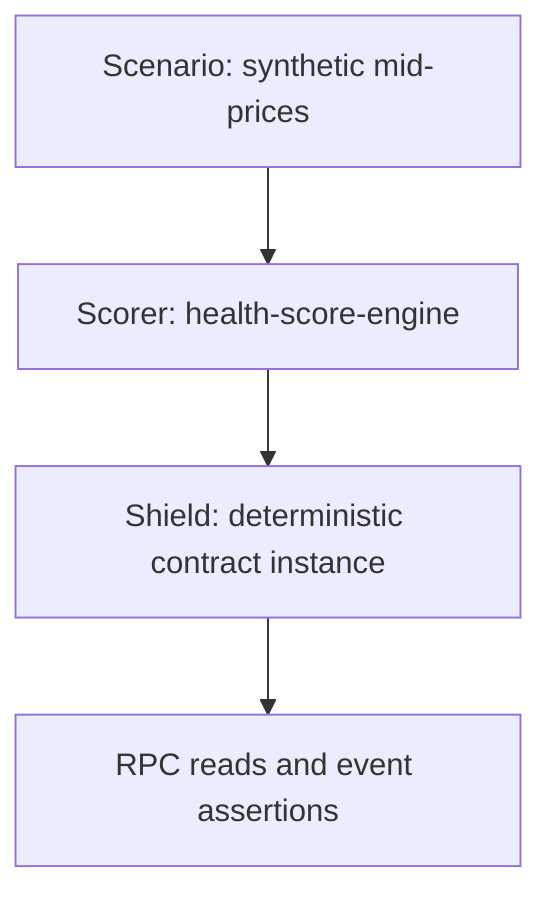

# Oracle Shield simulation suite

This Python test framework exercises the compiled Oracle Shield contract through Stellar RPC. It simulates different inputs — operator reports, administrative configuration —  at differents levels of the Oracle Shield workflow and checks the scores, statuses, and errors visible to consumers.

```
 stellar       | Sun Zu Lab infra                         | stellar
---------------|------------------------------------------|-------------
L5             | L4            L3             L2          | L1       L0
 ↓             |  ↓             ↓              ↓          |  ↓        ↑
 [SDEX/CEX] →  |  [ingestion] → [indicators] → [scorer] → |  [contract]
```

* L2: indicators simulation - publish mid price
* L1: scorer simulation - set_score
* L0: contract result - get_score / get_status / event notification

The framework is composed of:
* a module `stellar_oracle_shield_simulation_suite` providing the simulation tools and the scenarios
* a generated module `stellar_oracle_shield_client` providing bindings to for oracle shield contract calls
* an application `generate-bindings` to generate it from a contract wasm
* a pytest core starting the different scenarios


## Prerequisites

- Python 3.10 or later.
- Docker with its daemon running for local stellar node and local scorer.
- [Poetry](https://python-poetry.org/docs/).
- Compiled contract Wasm. Local builds require Rust and the `wasm32v1-none` target.

## Quick start

From the repository root, start the simulation environment:

```bash
cargo build-wasm
cd simulation
poetry install
poetry run generate-bindings
./start-local-node
./start-local-scorer
```

`poetry run generate-bindings` reads local WASM and does not require a running network. Generate it before pytest collection on a fresh checkout, and regenerate after every WASM change.

`start-local-node` starts an ephemeral `stellar-local` container with no persistent volume. Stopping it removes network state. On the next run, the simulator funds new identities and deploys contracts lazily as scenarios need them.

`start-local-scorer` starts the Sun Zu Lab scoring engine. It is required only for scorer scenarios.

Check RPC readiness; repeat until `result.status` is `healthy`:

```bash
curl --fail --silent --show-error http://localhost:8000/rpc \
  -H 'Content-Type: application/json' \
  --data '{"jsonrpc":"2.0","id":1,"method":"getHealth"}'
```

Run the simulation:

```bash
poetry run pytest -v
```

Then stop the simulation environment:

```bash
./stop-local-scorer
./stop-local-node
```


## Configuration

The local Quickstart uses `simulation/config.yaml` configuration.

Use `/rpc` consistently in `config.yaml` and local defaults. The network passphrase must match the node when signing transactions.

Pytest supports selecting a configuration:

```bash
poetry run pytest --config config.yaml -v
```

## Discovery and selection

```bash
# Discover
poetry run pytest --collect-only -v

# Run a subset
poetry run pytest -v -k quorum

# Run contract only tests - requires only the local Stellar node
poetry run pytest tests/test_contract.py -v

# Run scorer tests - requires both the local node and scorer
poetry run pytest tests/test_scorer.py -v
```

## Writing a scenario

Contract scenarios live in `src/stellar_oracle_shield_simulation_suite/scenarios/contract/`.
Scorer scenarios live in `src/stellar_oracle_shield_simulation_suite/scenarios/scorer/`.
Scenario extension is straighforward: just drop-in new files.
Name each module `scenario_*.py` and export `run(simulator)`.

For example, add `scenario_missing_pair.py`:

```python
from stellar_oracle_shield_simulation_suite.simulator import (
    DEFAULT_BASE,
    DEFAULT_QUOTE,
    OracleShieldError,
    Simulator,
    expect_contract_error,
)


def run(simulator: Simulator) -> None:
    """Reject reads for a pair with no operator report."""
    user = simulator.get_user()

    with expect_contract_error() as returned:
        user.get_score(DEFAULT_BASE, DEFAULT_QUOTE)

    assert returned.error == OracleShieldError.PairNotCovered, returned.error
```

Contract-only cases use `Simulator` fixture: each case receives a fresh simulator and, on first use, fresh accounts and a contract instance.

Scorer cases use `DeterministicSimulator` fixture, which reuses a fixed deployer and contract address; its on-chain state is shared across cases and repeated runs until the local network is reset.


## Scorer integration scenarios

These scenarios test the path from synthetic indicator input through the Dockerized scorer to on-chain score publication. They do not replay exchange ingestion or execute a consuming lending protocol.



### Configuration files and identities

| File | Purpose |
| --- | --- |
| `config.yaml` | Python RPC URL/passphrase, WASM path, UDP destination, and scorer public key. |
| `scorer.config.toml` | Scorer UDP listener, publisher RPC URL, signing-key path, fixed contract address, and publication interval. |
| `scorer.scorings.json` | Input venue/instrument mapping, score formula, and destination SAC pair. |
| `scorer.operator.key` | Fixed local-test signer used by the scorer. The Python configuration contains its public key only. |

Keep the following consistent:

- The scorer signing key and `simulator.scorer.public_key`.
- The network passphrase in Python and scorer configuration.
- The address printed by `DeterministicSimulator` and `[publisher].contract`.
- The venue/instrument strings emitted by a scenario and those declared in `scorer.scorings.json`.

The fixed identities are development fixtures. The deterministic address depends on deployer, salt, and network, not the WASM hash. Existing matching WASM is reused; different WASM at that address raises an error. Reuse does not rerun the constructor or reset configuration/reports.

### Current scoring rule

The bundled USTRY/USDC rule compares a Stellar market mid-price with an Etherfuse reference mid-price:

| Formula input | Venue | Instrument |
| --- | --- | --- |
| `sdex` | `stellar` | `USTRY.GCRYUGD5N-USDC.GA5ZSEJYB` |
| `reference` | `etherfuse` | `USTRY-USDC` |

The configured expression is:

```text
relative_deviation = abs(sdex - reference) / reference
raw_score = max(0, 100 - 10000 * relative_deviation)
```

For a positive reference price, equal prices yield 100, a 0.5% deviation yields 50, and a deviation of at least 1% yields 0.

The current `price_distortion` scenario uses:

| Step | Reference | Stellar mid-price | Expected result |
| --- | ---: | ---: | --- |
| Baseline | 1.06 | 1.056 | Raw formula approximately 62.264; the scenario expects integer score 62 (Degraded). |
| Price distortion | 1.06 | 107 | Score 0 and an Unsafe status-change event. |

The scenario checks the committed baseline score and then the score/status events after distortion

The extreme-price input is a synthetic divergence scenario. It is not a full reproduction of the historical incident mentioned in the scenario's source comment.

### Shared state and repeatability

Run scorer scenarios sequentially against this fixed contract and scorer. Each scenario should establish its required operator set, quorum, deviation, freshness settings, and baseline inputs. Python fixture scope alone does not isolate the on-chain state or the scorer's retained inputs and queued publications.

For a clean environment, stop the scorer before the node, then start both again and rerun setup. Stopping only the scorer does not clear contract state; stopping only the node does not clear scorer memory.

## Troubleshooting

| Symptom | Check |
| --- | --- |
| Missing generated bindings | Run `poetry run generate-bindings` before pytest, including collection. |
| Missing WASM | Build it, check `wasm_path`, and run from `simulation/`. |
| RPC unavailable | Check `docker logs stellar-local`, the endpoint, and RPC health. |
| Container name exists | Check whether `stellar-local` is already running. |
| Authentication failure | Check network passphrase, signer, and configured roles. |

## Related documentation

- [Project overview and consensus rules](../README.md)
- [Threat model](../THREAT_MODEL.md)
- [Rust contract tests](../contracts/oracle-shield/src/contract/tests.rs)
